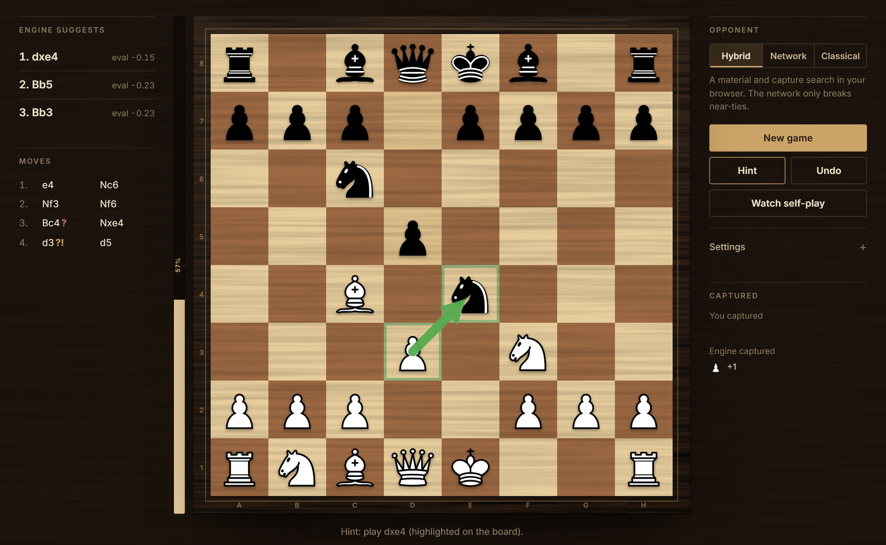
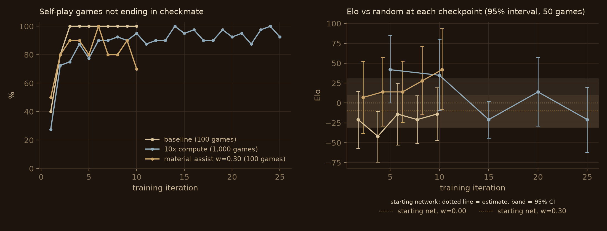

# RL-Chess-Engine

[](https://rlchess.xyz/)

[](https://rlchess.xyz/)
[](https://rl-chess-engine.onrender.com/)
[](https://github.com/Danny-397/RL-Chess-Engine/actions/workflows/tests.yml)
[](LICENSE)

**▶ Play it live: [rlchess.xyz](https://rlchess.xyz/)** &nbsp;·&nbsp; mirror: [onrender.com](https://rl-chess-engine.onrender.com/)

<p align="center">
  <a href="https://rlchess.xyz/">
    
  </a>
</p>
<p align="center"><em>The Play view at rlchess.xyz: three opponents (the trained network alone, a hybrid search, and a classical alpha-beta engine), with move suggestions and an evaluation bar.</em></p>

An **AlphaZero-style chess engine written from scratch in Python and PyTorch**: a
residual policy/value network, Monte-Carlo tree search, and a self-play training loop
that learns with no opening books and no human games. It is exported to ONNX and runs
in your browser at [rlchess.xyz](https://rlchess.xyz/), alongside a classical alpha-beta
engine. Around it is a controlled, multi-seed study of how self-play training behaves
at small scale.

## The research question

Self-play at hobby scale tends to collapse into threefold repetition within a few
iterations (the *draw cycle*). The study asks whether that cycle is what stops the
network from improving, using a starting-network control, three seeds per arm, and a
confidence interval on every Elo figure. Two real bugs in the search were found and
fixed along the way, each with a test that reproduces it.

<details>
<summary><b>Research log</b>: each experiment and what it showed</summary>

| When | What happened |
|---|---|
| July 2026 | One GPU run, one seed per arm, suggested that blending a material count into the search breaks the cycle (−21 → +28 Elo). I published it as the headline. |
| 14 Nov | Found the flaw: each arm was evaluated with its own training search, with no comparison to the network it started from. **Withdrew the headline**, and fixed a draw rule that ended games before anyone had repeated. |
| 15–16 Nov | Reran properly: three seeds per arm, every network against its own start. Training inside the cycle made the network **worse** (−93 Elo vs random, 95% CI −125 to −60). The July gain did not replicate. |
| 16–17 Nov | Scoring drawn games by material: the value head learned a little, play did not change (−93 again). Reading the search code found a bug: it could not see repetitions of earlier positions in the game. Fixed, with a test that reproduces it. |
| 18 Nov | The last test: fixed search + contempt (each side treats a draw as slightly bad for itself in self-play) + the material target. Repetitions fell from 82% of self-play games to 16% and checkmates tripled, but the network still got **worse by the same amount** (−91, 95% CI −123 to −60). The cycle was real; it was not the cause. |

</details>

**What I took from it:** one run with no reference point can produce a convincing effect
that is not there. The habits that caught it, a starting-network control, several seeds,
and an interval on every number, are now how every result here is measured. The two real
bugs were found by reading code, not by more GPU time, and fixing the thing I blamed was the only
way to learn it was not the cause.

Full write-up: the [Findings page](https://rlchess.xyz/#findings), the
[technical report](docs/technical-report.md), and [the story behind it](docs/reflection.md).

## What is in it

The same three ideas that powered DeepMind's AlphaZero, implemented to be *read and understood*:

1. A **deep residual neural network** that looks at a position and outputs both a
   move-preference (**policy**) and an estimate of who is winning (**value**).
2. **Monte-Carlo Tree Search (MCTS)** that uses the network to look ahead and
   produce much stronger move choices than the raw network alone.
3. A **self-play training loop** that turns those searches into training data and
   feeds the improved network back into the search.

The site also has a classical **alpha-beta engine** (about 1390 against strength-limited
Stockfish), because the self-play network is too weak to be fun to play. One piece of human
knowledge is on by default at play time: the network's search blends in a material count
(`material_weight = 0.30`). Set it to `0.0` for pure AlphaZero.

### What this project demonstrates

- **Reinforcement learning from scratch** — the full AlphaZero loop (network ↔ search ↔ self-play), no RL libraries.
- **Search algorithms** — PUCT Monte-Carlo Tree Search *and* a classical alpha-beta engine (negamax, quiescence, piece-square evaluation).
- **Deep learning in PyTorch** — a dual-headed residual CNN, custom loss, training loop and checkpointing.
- **Software engineering** — modular design, a 62-test suite, CI, typed config, and a deployed full-stack web app (FastAPI + a hand-built board UI).
- **Engineering judgement** — diagnosing and solving real problems under real constraints (see *Engineering decisions & challenges* below).

---

## Why this is interesting

AlphaZero is famous for being conceptually simple but subtle to get *right*. This
repo deliberately surfaces the parts that are easy to get wrong, with tests to
prove they're correct:

- **Perspective handling.** The network always sees the board from the side to
  move's point of view (the board is mirrored when it's Black's turn), and value
  signs are flipped correctly as they propagate up the search tree. A single sign
  error here silently breaks learning — so there are tests for it.
- **The full AlphaZero move encoding.** Moves are encoded into the canonical
  `8 × 8 × 73 = 4672`-dimensional action space (queen moves, knight moves and
  under-promotions), with round-trip tests.
- **Search as policy improvement.** MCTS visit counts — not the raw network
  output — are used as the training target, which is precisely what makes the
  network get stronger over time.

---

## Architecture at a glance

```
                 +-------------------+
                 |   self_play.py    |  plays the engine against itself,
                 |  (data generator) |  records (state, MCTS policy, outcome)
                 +---------+---------+
                           |  training examples
                           v
   +-----------+     +-----------+     +-------------------+
   |  mcts.py  |<----|  model.py |     |   training.py     |
   |  (search) |     | (ResNet)  |---->| (loss + optimise) |
   +-----+-----+     +-----------+     +---------+---------+
         |  uses network priors + value           |  updated weights
         |                                         v
         |                                  checkpoints/*.pt
         v
   +-------------+
   | chess_game  |  rules, board<->tensor encoding, move<->index encoding
   | (.py)       |  (built on python-chess)
   +-------------+
```

| File             | Responsibility |
|------------------|----------------|
| `config.py`      | All hyper-parameters in one typed, documented place. |
| `chess_game.py`  | Rules wrapper + board→tensor and move↔index encodings. |
| `model.py`       | The dual-headed residual policy/value network. |
| `mcts.py`        | PUCT Monte-Carlo Tree Search guided by the network. |
| `self_play.py`   | Generates `(state, policy, value)` training data via self-play (sequential **and** multiprocessing), with PGN export. |
| `training.py`    | Loss function, replay buffer, training loop, checkpointing, periodic evaluation. |
| `evaluation.py`  | Pluggable agents, match play, and an approximate **Elo** estimate. |
| `analysis.py`    | Engine move recommendations + win-probability (powers `hint`/`analyze`). |
| `main.py`        | CLI entry point: `--mode train` / `play` / `eval` / `analyze` / `serve`. |
| `web/`           | Optional FastAPI backend + chessboard.js front-end (browser play). |
| `tests/`         | Pytest suite covering encoding, model, search, self-play and evaluation. |

---

## Installation

```bash
git clone https://github.com/Danny-397/RL-Chess-Engine.git
cd RL-Chess-Engine
python -m venv .venv && source .venv/bin/activate   # optional but recommended

pip install -r requirements.txt                     # play the demo (torch-free)
pip install -r requirements-train.txt               # ALSO train the network + tests
```

Requires Python 3.10+. The playable demo (classical engine) needs only
`requirements.txt`; training the AlphaZero network and running the test suite also
need `requirements-train.txt` (PyTorch). A GPU is optional.

---

## Quick start

### Play in the browser (web UI)

The most demoable way to play: a drag-and-drop board with a live evaluation bar
and a "recommended moves" panel.

```bash
pip install -r requirements.txt       # python-chess + fastapi + uvicorn (no torch)
python main.py --mode serve           # then open http://127.0.0.1:8000
```

You play White by dragging pieces; the engine replies, the **Hint** button asks
it to recommend moves for your position, the eval bar tracks who's ahead, and a
banner announces checkmate/draw. The backend is stateless (the browser sends the
position as FEN).

> **Which engine plays you** — the web UI has an **Opponent** selector with four choices:
>
> - **Hybrid** *(default)* — a material + quiescence negamax search that runs **entirely in your
>   browser**, with the trained value network (via [onnxruntime-web]) as a tie-break worth at most
>   40 centipawns. It mostly plays like the search; the network only separates near-equal moves.
>   Difficulty sets the search depth (1/2/3 ply).
> - **Network** — the trained value network alone: a 1-ply value lookup with no search and no chess
>   knowledge added. The shipped weights are `checkpoints/best.pt`, the GPU-trained material-assisted
>   network from seed 1 of the 2026-11 rerun (chosen before any results were seen). Its value head
>   learned almost nothing (§ Training results), so it is weak.
> - **Classical** — the dependency-light alpha-beta searcher ([`search.py`](search.py):
>   negamax, quiescence, piece-square tables, endgame mop-up), served by the backend. It plays sound
>   chess and beats the random baseline 10–0. Against Stockfish 19 held to `UCI_Elo 1320` (0.1 s/move),
>   the **Easy** setting (depth 2) scored **14 wins, 8 draws, 8 losses**: an estimated **~1390**
>   (95% CI 1284–1512) on Stockfish's engine-rating scale, not a FIDE or chess.com rating
>   ([`tools/stockfish_rating.py`](tools/stockfish_rating.py), [result](docs/data/stockfish_rating_d2_e1320.json)).
>   Normal (depth 3) is stronger but ~20× slower per move and has not been rated yet.
>   Tune it with `--depth` (CLI) / `RLCHESS_DEPTH` (server).
> - **Two players** — two people share the board.
>
> The network runs client-side from [`web/static/model.onnx`](web/static/model.onnx), gated by a
> **golden self-check** (`model_meta.json`) that confirms the browser's board-encoding matches
> Python before the net is ever used; if the file or check is missing, the net options fall back to
> the classical search. To drop in a **retrained** model, export it with the last cell of the
> [Colab notebook](#training-results-and-an-honest-note-on-scale) (writes `model.onnx` +
> `model_meta.json`) and redeploy — no code changes.

[onnxruntime-web]: https://onnxruntime.ai/docs/tutorials/web/

#### Deploy the web UI to Render (one lightweight service)

Because the demo engine is torch-free, the whole site — board **and** API — runs
as a single tiny service that fits Render's free tier. A [`render.yaml`](render.yaml)
blueprint is included:

1. Push this repo to GitHub (already done if you cloned it from there).
2. On [Render](https://render.com): **New + → Blueprint**, pick this repo, **Apply**.
3. Open the URL Render gives you and play. That URL is the complete site.

Or configure a **Web Service** manually:

| Setting | Value |
|---|---|
| Build command | `pip install --upgrade pip && pip install -r requirements.txt` |
| Start command | `uvicorn web.server:app --host 0.0.0.0 --port $PORT` |
| Env var | `RLCHESS_DEPTH=3` (4 = stronger, slower) |

The blueprint binds `0.0.0.0:$PORT` (Render injects `$PORT`; the local default is
`127.0.0.1:8000`) and exposes a `/health` endpoint for the readiness check.

#### Deploy the whole app to Vercel

Because the demo engine is torch-free and tiny, the **entire site (board + API)
now runs on Vercel** as a Python serverless function — no split, no separate
backend. The repo is preconfigured for it:

- [`api/index.py`](api/index.py) exports the FastAPI app as the serverless function;
- [`vercel.json`](vercel.json) routes every request to it and bundles `web/static`;
- the root [`requirements.txt`](requirements.txt) is torch-free, so the function
  installs in seconds and stays well under Vercel's size limit;
- [`.vercelignore`](.vercelignore) keeps the training stack out of the bundle.

To deploy: on [Vercel](https://vercel.com), **Add New → Project**, import this
repo, and **Deploy** (no settings to change). Open the URL and play.

### Play against the engine (console)

Play the classical engine straight away (no checkpoint or torch needed):

```bash
python main.py --mode play            # add --depth 4 for a stronger opponent
```

You enter moves in standard algebraic notation (`e4`, `Nf3`, `O-O`, `exd5`,
`e8=Q`). During your turn you can also type:

- **`hint`** — the engine analyses *your* position and prints its top recommended
  moves (ranked by search effort) plus your win probability;
- **`eval`** — show the engine's evaluation of the current position;
- `board` to redraw, `quit` to resign.

The engine also reports its own win estimate each time it moves.

> The bundled checkpoint (`checkpoints/best.pt`) is the seed-1 material-assisted network from
> the 2026-11 GPU rerun (10 iterations): a demonstration of the pipeline, not a strong player.

### Analyse any position

Get the classical engine's evaluation and recommended moves for a position without
playing a whole game (depth 4 by default, `--depth` to change). It defaults to the
opening, or pass any FEN:

```bash
python main.py --mode analyze
python main.py --mode analyze --fen "r1bqkbnr/pppp1ppp/2n5/4p3/4P3/5N2/PPPP1PPP/RNBQKB1R w KQkq - 0 1" --top-n 5
```

Output for the starting position:

```
Engine eval: +0.00  (win probability for side to move: 50%)
Recommended moves:
  1. Nf3     eval +0.00
  2. Nc3     eval +0.00
  3. e4      eval -0.02
  4. d4      eval -0.02
  5. e3      eval -0.07
```

### Train your own engine

```bash
# A short demo run (minutes on a CPU):
python main.py --mode train --iterations 5 --games 4 --simulations 50

# A more serious run (uses the defaults in config.py):
python main.py --mode train
```

Checkpoints are written to `checkpoints/` and progress is logged to
`logs/training.log`. The final model is saved as `checkpoints/best.pt`, which is
the default the `play` mode looks for.

#### Faster training: parallel self-play

Self-play (not the gradient updates) dominates AlphaZero's runtime, and games are
independent — so they fan out across CPU cores almost perfectly:

```bash
python main.py --mode train --workers 8        # 8 self-play worker processes
```

Workers each rebuild the network from the current weights and run on CPU (pinned
to one thread each to avoid oversubscription); their `(state, policy, value)`
examples are collected back in the main process for the gradient step.

#### Archiving games + tracking strength during training

```bash
# Save every self-play game to pgn/selfplay_iterNNN.pgn, and every 5 iterations
# play a quick match vs a random baseline and log the estimated Elo gain:
python main.py --mode train --save-pgn --eval-every 5
```

### Measure engine strength (Elo)

The `eval` mode plays a match and reports a win/draw/loss tally plus an
approximate Elo difference (colours are alternated so first-move advantage
cancels out):

```bash
# Trained engine vs. the random baseline (the basic "did it learn?" test):
python main.py --mode eval --checkpoint checkpoints/best.pt --opponent random --eval-games 40

# Head-to-head between two checkpoints (did training iteration N beat iteration M?):
python main.py --mode eval --checkpoint checkpoints/checkpoint_iter020.pt \
                           --opponent checkpoints/checkpoint_iter010.pt --eval-games 40

# Optionally dump the played games to a PGN file with --pgn-out games.pgn
```

Elo is derived from the expected score `S` by the standard logistic relation
`elo = -400 · log10(1/S − 1)`, so 50% → ±0, ~64% → ~+100, etc.

### Run the tests

```bash
pytest -q
```

The same suite runs automatically on every push via GitHub Actions (see the
`tests` badge above).

### Tracking training progress

Training appends a per-iteration loss breakdown to `logs/training.log`, plus a
periodic Elo estimate against the random baseline. Turn that log into charts:

```bash
python plot_progress.py            # -> assets/training_progress.png
```

This produces two plots — training loss over time, and estimated Elo vs. random
over time — which together answer the only questions that matter: *is the network
fitting the data, and is the engine actually getting stronger?*

### Training results (and an honest note on scale)

**Three training seeds per arm** (Kaggle T4, 2026-11-15/16), under the corrected draw rule,
each network measured against **its own starting network** under the same evaluation
([data](docs/data/seeds_rerun_2026-11.json), built by [`tools/summarise_seeds.py`](tools/summarise_seeds.py);
[report §5.8](docs/technical-report.md)). Each arm: 10 iterations × 10 self-play games × 100 simulations.
Pooled over seeds 1–3:

| Arm | Evaluated against | Trained | Starting network | Change, Elo (95% CI) |
|---|---|---|---|---|
| baseline | random | −19 | +74 | **−93 (−125, −60)** |
| baseline | material-greedy | −524 | −369 | **−155 (−265, −45)** |
| assisted | random, its own search (w = 0.30) | +2 | −3 | +6 (−19, +31) |
| assisted | random, network only (w = 0) | −30 | +74 | −104 (−136, −72) |
| assisted | material-greedy (w = 0) | −432 | −369 | −63 (−154, +28) |

- **Training in the draw cycle made the networks worse.** The baseline lost 93 Elo against
  random and 155 against a one-ply material grabber, relative to the untrained network it
  started from. Two of three seeds drop sharply; seed 3 started weak and stayed level.
- **The material assist only held its ground.** In its own search it is unchanged (+6);
  without the blend its network is as degraded as the baseline's. The July "+31" for this arm
  (one seed) does not replicate.
- **The draw cycle is real, and the rule fix did not cause it.** From iteration 3, 89–100% of
  self-play games end without checkmate, nearly all in genuine threefold repetition. The same
  seed-1 baseline under the old claimable-draw rule: 89% non-decisive overall vs 82% corrected,
  a modest difference from one seed.
- **The value heads stay flat.** "Up a queen" minus "down a queen" on a −1 to +1 scale is
  +0.000 to +0.009 for five of six networks; seed-1 baseline reaches +0.06 (0.04, 0.08)
  ([`tools/value_probe.py`](tools/value_probe.py)).

**Two more suspects (2026-11-16/17).** Giving drawn games a value target from the final material
balance (`--draw-target material`, same three seeds) left the change vs start at **−93 (−122, −63)**
against random, the same as the baseline, with 87–95% of self-play still non-decisive
([data](docs/data/draw_material_2026-11.json)). Its value heads did learn more material
(up minus down a queen +0.04 to +0.14, [probe](docs/data/value_probe_material_2026-11.json)).
Separately, `ChessGame.clone()` dropped the move history, so MCTS could not see a threefold
involving positions from before the search root. Clones now keep the reversible history;
every number above used the old search (`--legacy-search-history` reproduces it).

**Breaking the cycle (2026-11-18).** [`notebooks/draw_contempt.ipynb`](notebooks/draw_contempt.ipynb):
the fixed search, three seeds per arm, 300 self-play games per arm, against starting networks
re-measured with the fixed search (+73 vs random, unchanged from +74)
([data](docs/data/draw_contempt_2026-11.json)):

| Arm | Repetitions | Checkmates | 200-move cap | Change vs start, Elo (95% CI) |
|---|---|---|---|---|
| fixed search | 246 | 32 | 22 | −94 (−128, −60) |
| + contempt 0.2 | 178 | 49 | 73 | −91 (−121, −62) |
| + contempt + material target | 49 | 94 | 157 | **−91 (−123, −60)** |

Contempt with the material target broke the cycle (repetitions 82% → 16%, checkmates ×3, most of
the rest hitting the move cap, which still carry a material target) and its value heads learned the
most material (+0.05 to +0.20). The network still declined by the same amount, so the draw cycle is
not why training makes it worse; the likeliest remaining cause is too little data (100 games per run),
which these runs cannot test. **This was the last training run.**

The July GPU run (one seed per arm, [full data](docs/experiment-results.md)) is kept for
the record. Its headline, "the assist flips Elo from −21 to +28: a signal problem, not
compute", was **withdrawn on 2026-11-14**: the arms were evaluated with different searches,
with no starting-network reference and no intervals ([report §5.4](docs/technical-report.md)).



*The July run's draw cycle (one seed, old draw rule).*

**To reproduce** the rerun, run [`notebooks/seeds_rerun.ipynb`](notebooks/seeds_rerun.ipynb) on a Kaggle T4.
Training takes about 11.5 h, so run the starting-network controls (its section 3 onward) on a
second session or locally, then `python tools/summarise_seeds.py`. The July run is
`python run_experiment.py --device cuda --legacy-draw-claims`.

---

## How it works (the 3-minute version)

> For a fuller treatment with the underlying math (PUCT, the loss function, and
> why the self-play loop converges), see [docs/how-it-works.md](docs/how-it-works.md).

**1. The network (`model.py`).** A small ResNet takes an `18 × 8 × 8` tensor of
the position and produces a policy (4672 logits, one per possible move) and a
scalar value in `[-1, 1]`. Sharing a trunk between the two heads is multi-task
learning: features useful for *choosing* a move also help *judging* a position.

**2. The search (`mcts.py`).** Pure neural-network move choice is short-sighted.
MCTS runs many simulations, each descending the game tree by the **PUCT** rule

```
score(move) = Q(move) + c_puct · P(move) · √N(parent) / (1 + N(move))
```

which balances exploiting moves with a high running value `Q` against exploring
moves the network rates highly (`P`) but hasn't tried much. Leaves are evaluated
by the network's value head (no random rollouts), and the value is backed up the
tree, flipping sign each ply because the players alternate.

**3. Self-play & training (`self_play.py`, `training.py`).** The engine plays
itself; for each position it stores the board, the MCTS visit distribution (a
*sharpened* policy), and — once the game ends — who won. The network is then
trained to match those policies (cross-entropy) and outcomes (MSE):

```
loss = −Σ π · log p(·)   +   c · (z − v)²   +   L2 regularisation
```

A stronger network produces stronger self-play, which produces better data, which
produces a stronger network. That loop is the whole idea.

---

## Extending it

The code is built to be tinkered with:

- **Different network?** Edit `model.py` (or swap in your own `nn.Module` that
  returns `(policy_logits, value)`). Adjust depth/width in `config.NetworkConfig`.
- **Stronger / faster search?** Change `num_simulations` and `c_puct` in
  `config.MCTSConfig`.
- **Training behaviour?** Everything (learning rate, batch size, games per
  iteration, replay buffer size, temperature schedule) lives in
  `config.TrainingConfig`.

---

## Engineering decisions & challenges

The interesting part of a project is rarely the happy path. A few real problems
this one ran into, and how they were solved:

- **The "draw cycle."** An *under-trained* network + MCTS won material but couldn't
  convert — self-play games ended in threefold repetition, and against a random-move
  opponent it drew 84–90% of games. Diagnosing this (logging *why* each game ended) showed
  the value head only ever saw drawn outcomes, so it never learned what *winning*
  looked like. **Decision:** for the playable demo, add a dependency-light classical
  **alpha-beta engine** (`search.py`) that plays sound chess *today* (it beats the
  random baseline 10–0), while keeping the neural network + MCTS as the learning
  project. Two engines, each used where it's strongest.
- **"Weird" openings.** The alpha-beta engine first only valued material, so every
  opening move scored 0 and it played randomly (knights to the rim, rook shuffles).
  **Fix:** piece-square tables — now it develops toward the centre and castles
  sensibly, with no training required.
- **Converting won endgames.** Material alone can't deliver mate. **Fix:** an
  endgame "mop-up" evaluation (drive the lone king to a corner, shrink its escape
  squares) plus scoring repetition/stalemate as 0 — so the engine seeks the
  *fastest* mate instead of stalling.
- **Memory limits.** Training crashed with `OpenBLAS`/paging errors when parallel
  self-play spawned many PyTorch workers on a small machine, and orphaned worker
  processes piled up. **Fixes:** cap BLAS threads before importing numpy, and fall
  back to sequential self-play when memory is tight.
- **Deployability.** A PyTorch web service is too big for free serverless/instances
  (the multi-GB CUDA wheel, the 250 MB serverless limit). **Decision:** because the
  demo engine is *torch-free*, the deployed app needs only `python-chess` + FastAPI
  — a tiny service that runs on a free tier and even fits a Vercel function.
- **Reproducibility.** A search with hidden randomness is impossible to debug, so
  MCTS is deterministic without exploration noise — and there's a test that proves
  it.

## Roadmap

- Finished as a study: at 100 self-play games per run, ideas can be ruled out but rarely ruled in.
  With real compute, the open question is whether far more self-play data stops the decline.
- Batched MCTS leaf evaluation to make GPU self-play far faster.

---

## Limitations & honest notes

- This is an **educational** engine. With modest simulation counts and a small
  network it will not approach strong engines like Stockfish or Leela.
- Self-play (not the network) dominates runtime, the usual AlphaZero bottleneck.
  Multiprocessing self-play (`--workers`) addresses this on a single machine; the
  next step up would be distributing self-play across multiple machines.
- For clarity the board encoding omits move-history planes (used by the original
  AlphaZero to detect repetitions); this is a documented simplification.

---

## References

- Silver et al., *"A general reinforcement learning algorithm that masters chess,
  shogi, and Go through self-play"*, Science 2018 (AlphaZero).
- Silver et al., *"Mastering the game of Go without human knowledge"*, Nature 2017
  (AlphaGo Zero).
