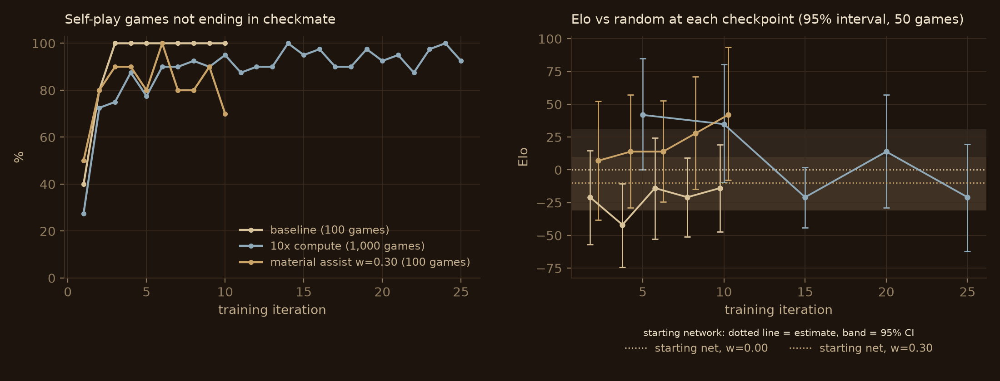

# Draw-Cycle Experiment Results

**Hardware:** Kaggle, 2× Tesla T4 (GPU) · **Driver:** `python run_experiment.py --device cuda`
**Date:** 2026-07-14 · **Training wall-clock:** ~9.8 h (baseline 68.9 min + scaled 444.7 min + assisted 75.2 min)

> **Provenance.** The Kaggle notebook's automatic `git push` failed with a 403 (its
> `GITHUB_TOKEN` secret lacked write scope), so every number in this file is
> transcribed directly from that run's captured stdout — the per-iteration
> self-play termination tables, the periodic evaluation lines, and the loss curve.
> Two things could **not** be recovered from the surviving logs and are marked where
> they appear: (1) the win/draw/loss split of each stage's *final* stand-alone
> 50-game evaluation (only its Elo survived), and (2) a downloadable trained
> checkpoint, which was lost with the Kaggle session (re-run the driver to
> regenerate one). The figures below are plotted directly from the per-iteration
> numbers transcribed in this file.



*Rebuilt by [`tools/plot_draw_cycle.py`](../tools/plot_draw_cycle.py) from
[`data/gpu_run_2026-07-14.json`](data/gpu_run_2026-07-14.json) (this file's tables, machine-readable)
and [`data/start_network_control.json`](data/start_network_control.json).*

> **Re-analysis, 2026-11-14 — read this first.** The original conclusions below
> ("the signal lever flips Elo from −21 to +28; the draw cycle is primarily a
> signal problem") do not survive a closer look:
>
> 1. **Confound.** Each network was evaluated with the search it trained under, so
>    the assisted network's Elo was measured *with* the material heuristic in its
>    search and the baseline's without. Arms were never compared under the same search.
> 2. **No starting-network reference.** All three arms trained from the same seed-42
>    initial network. Rebuilt and evaluated under the same settings, it scores
>    **0 (95% CI −31, +31)** against random with `material_weight = 0` and
>    **−10 (−31, +10)** with 0.30 ([`tools/no_learning_control.py`](../tools/no_learning_control.py),
>    [data](data/start_network_control.json)). The heuristic on its own does not beat random.
> 3. **No intervals.** A 50-game match against random is about ±40 Elo at 95%, and
>    untrained networks alone span −7 to +120 Elo across init seeds
>    ([data](data/no_learning_control.json)).
>
> Change against the starting network, pooling each arm's five checkpoints (250 games):
>
> | Arm | Trained, pooled | Starting network | Change (95% CI) |
> |---|---|---|---|
> | baseline | −22 (−38, −7) | 0 (w = 0) | −22 (−56, +12) |
> | scaled (10×) | +10 (−8, +28) | 0 (w = 0) | +10 (−26, +45) |
> | assisted | +21 (+1, +41) | −10 (w = 0.30) | **+31 (+3, +60)** |
>
>
> 4. **Draw rule (found later the same day).** Games ended as soon as a repetition could be
>    *claimed*, which python-chess allows when the side to move merely has a repeating move
>    available. Every "REP" count below includes games that ended before anyone repeated; the
>    search also scored those positions as draws. All arms shared the rule, so comparisons hold,
>    but the rates are inflated. The rule is fixed; see technical report §5.5.
>
> What holds: the draw cycle in self-play (the termination tables in §A are unaffected),
> and a small, marginal gain for the assisted arm over its own start, from one training
> seed. Neither unassisted arm measurably changed strength. The repo assumes the code was
> unchanged between this run and the first commit (2026-07-18), which is when history begins.

## Run configuration

All three stages share the identical code and network (4 residual blocks, 64
channels); they differ only in the variable under test.

| Stage | Iterations | Games/iter | Total games | Sims/move | Self-play material w |
|---|---|---|---|---|---|
| baseline | 10 | 10 | 100 | 100 | 0.00 |
| scaled | 25 | 40 | 1,000 | 160 | 0.00 |
| assisted | 10 | 10 | 100 | 100 | 0.30 |

Evaluation at each checkpoint is 50 games vs. `RandomAgent` at 50 sims/move.

---

## Headline results

The driver's two headline metrics are the self-play **non-decisive rate** (fraction
of games *not* ending in checkmate) and **Elo vs. random**. "Non-decisive rate"
below is the **final iteration's** rate (the end-of-training state); the aggregate
over *all* of a stage's games is given alongside because for the baseline the two
differ sharply (see §A).

### Experiment A — compute scaling (material w = 0 in both)

| Run | Total games | Sims/move | Non-decisive (final iter / all games) | Elo vs random |
|---|---|---|---|---|
| baseline | 100 | 100 | 100% / 92% | −21 |
| scaled | 1,000 | 160 | 92% / 88% | −7 |

**Result.** 10× the self-play produces more checkmates in aggregate (8/100 = 8% →
120/1000 = 12%), but the cycle is not broken. The Elo difference (−21 → −7 on the final
50-game matches) is well inside the ±40 Elo noise of a single match; against the starting
network the scaled arm's change is +10 (95% CI −26, +45).

### Experiment B — self-play signal at fixed compute (same budget as baseline)

| Run | Total games | Sims/move | Material w | Non-decisive (final iter / all games) | Elo vs random |
|---|---|---|---|---|---|
| baseline | 100 | 100 | 0.00 | 100% / 92% | −21 |
| assisted | 100 | 100 | 0.30 | 70% / 81% | +28 |

**Result.** Blending a 0.30 material term into self-play leaf evaluation — at the
*same* compute as the baseline — drops the final-iteration non-decisive rate to 70% and
raises the aggregate checkmate count to 19/100. (The heuristic is active during self-play,
so some of those checkmates come from it directly.) The Elo comparison with the baseline
is confounded, because the two were evaluated with different searches; against its own
starting network under the same search, the assisted arm gained +31 Elo (95% CI +3, +60).

### Reading the two together
Only the assisted arm shows a measurable strength gain over its starting point, and only
just. This run cannot rank the two levers: one training seed per arm, and the arms differ
by less than seed-to-seed variation.

---

## A. Per-iteration self-play termination

Counts are games ending by each reason. **CM** checkmate · **ST** stalemate ·
**INSUF** insufficient material · **REP** threefold repetition · **50M** fifty-move ·
**CAP** hit the `max_moves = 200` cap. "Non-dec %" = fraction not won by checkmate.

### Baseline — 10 iters × 10 games, 100 sims, mat-w 0.00

| Iter | CM | ST | INSUF | REP | 50M | CAP | Non-dec % |
|---|---|---|---|---|---|---|---|
| 1 | 6 | 0 | 0 | 0 | 0 | 4 | 40% |
| 2 | 2 | 0 | 0 | 8 | 0 | 0 | 80% |
| 3 | 0 | 0 | 0 | 10 | 0 | 0 | 100% |
| 4 | 0 | 0 | 0 | 10 | 0 | 0 | 100% |
| 5 | 0 | 0 | 0 | 10 | 0 | 0 | 100% |
| 6 | 0 | 0 | 0 | 10 | 0 | 0 | 100% |
| 7 | 0 | 0 | 0 | 10 | 0 | 0 | 100% |
| 8 | 0 | 0 | 0 | 10 | 0 | 0 | 100% |
| 9 | 0 | 0 | 0 | 10 | 0 | 0 | 100% |
| 10 | 0 | 0 | 0 | 10 | 0 | 0 | 100% |
| **ALL** | **8** | 0 | 0 | **88** | 0 | **4** | **92%** |

*The draw cycle forming in real time: the early, near-random network scores a few
accidental checkmates (8 in iters 1–2), then collapses into pure threefold
repetition from iter 3 onward — zero checkmates for the last 80 games. Draws are
driven by **repetition**, not the fifty-move rule.*

### Scaled — 25 iters × 40 games, 160 sims, mat-w 0.00

| Iter | CM | ST | INSUF | REP | 50M | CAP | Non-dec % |
|---|---|---|---|---|---|---|---|
| 1 | 29 | 0 | 0 | 0 | 0 | 11 | 27.5% |
| 2 | 11 | 0 | 0 | 29 | 0 | 0 | 72.5% |
| 3 | 10 | 0 | 0 | 30 | 0 | 0 | 75.0% |
| 4 | 5 | 0 | 0 | 34 | 0 | 1 | 87.5% |
| 5 | 9 | 0 | 0 | 31 | 0 | 0 | 77.5% |
| 6 | 4 | 0 | 0 | 36 | 0 | 0 | 90.0% |
| 7 | 4 | 0 | 0 | 36 | 0 | 0 | 90.0% |
| 8 | 3 | 0 | 0 | 37 | 0 | 0 | 92.5% |
| 9 | 4 | 0 | 0 | 35 | 0 | 1 | 90.0% |
| 10 | 2 | 0 | 0 | 38 | 0 | 0 | 95.0% |
| 11 | 5 | 0 | 0 | 35 | 0 | 0 | 87.5% |
| 12 | 4 | 0 | 0 | 36 | 0 | 0 | 90.0% |
| 13 | 4 | 0 | 0 | 36 | 0 | 0 | 90.0% |
| 14 | 0 | 0 | 0 | 39 | 0 | 1 | 100.0% |
| 15 | 2 | 0 | 0 | 38 | 0 | 0 | 95.0% |
| 16 | 1 | 0 | 0 | 39 | 0 | 0 | 97.5% |
| 17 | 4 | 0 | 0 | 36 | 0 | 0 | 90.0% |
| 18 | 4 | 0 | 0 | 36 | 0 | 0 | 90.0% |
| 19 | 1 | 0 | 0 | 39 | 0 | 0 | 97.5% |
| 20 | 3 | 0 | 0 | 37 | 0 | 0 | 92.5% |
| 21 | 2 | 0 | 0 | 38 | 0 | 0 | 95.0% |
| 22 | 5 | 0 | 0 | 35 | 0 | 0 | 87.5% |
| 23 | 1 | 0 | 0 | 39 | 0 | 0 | 97.5% |
| 24 | 0 | 0 | 0 | 40 | 0 | 0 | 100.0% |
| 25 | 3 | 0 | 0 | 37 | 0 | 0 | 92.5% |
| **ALL** | **120** | 0 | 0 | **866** | 0 | **14** | **88%** |

*Same pattern at scale: iter 1's untrained net delivers 29 accidental mates, then
the rate settles into the high-80s/90s% non-decisive band for the rest of training.
More compute keeps a *residual* trickle of checkmates alive (120/1000 aggregate vs.
the baseline's 8/100) but does not escape the plateau.*

### Assisted — 10 iters × 10 games, 100 sims, mat-w 0.30

| Iter | CM | ST | INSUF | REP | 50M | CAP | Non-dec % |
|---|---|---|---|---|---|---|---|
| 1 | 5 | 0 | 2 | 1 | 0 | 2 | 50% |
| 2 | 2 | 0 | 0 | 7 | 0 | 1 | 80% |
| 3 | 1 | 0 | 0 | 9 | 0 | 0 | 90% |
| 4 | 1 | 0 | 0 | 9 | 0 | 0 | 90% |
| 5 | 2 | 0 | 0 | 8 | 0 | 0 | 80% |
| 6 | 0 | 0 | 0 | 10 | 0 | 0 | 100% |
| 7 | 2 | 0 | 0 | 7 | 0 | 1 | 80% |
| 8 | 2 | 0 | 0 | 7 | 0 | 1 | 80% |
| 9 | 1 | 0 | 0 | 9 | 0 | 0 | 90% |
| 10 | 3 | 0 | 0 | 7 | 0 | 0 | 70% |
| **ALL** | **19** | 0 | **2** | **74** | 0 | **5** | **81%** |

*With the material assist, checkmates keep appearing throughout training instead of
dying out — 19/100 aggregate, and the final iteration hits 30% checkmate (70%
non-decisive), the best of any stage. Decisive games give the value head a real
signal to learn from.*

---

## B. Elo vs. random — periodic evaluation checkpoints

Each row is an independent 50-game match vs. `RandomAgent` (50 sims/move), logged
during training at the stage's `eval_every` interval. W/D/L are the raw counts.

### Baseline (every 2 iters)

| Iter | W | D | L | Score | Elo | 95% CI |
|---|---|---|---|---|---|---|
| 2 | 2 | 43 | 5 | 47.0% | −21 | −57 to +15 |
| 4 | 0 | 44 | 6 | 44.0% | −42 | −74 to −10 |
| 6 | 3 | 42 | 5 | 48.0% | −14 | −53 to +24 |
| 8 | 1 | 45 | 4 | 47.0% | −21 | −51 to +9 |
| 10 | 2 | 44 | 4 | 48.0% | −14 | −47 to +19 |

### Scaled (every 5 iters)

| Iter | W | D | L | Score | Elo | 95% CI |
|---|---|---|---|---|---|---|
| 5 | 8 | 40 | 2 | 56.0% | +42 | +0 to +85 |
| 10 | 8 | 39 | 3 | 55.0% | +35 | −9 to +80 |
| 15 | 0 | 47 | 3 | 47.0% | −21 | −44 to +2 |
| 20 | 6 | 40 | 4 | 52.0% | +14 | −29 to +57 |
| 25 | 3 | 41 | 6 | 47.0% | −21 | −62 to +20 |

### Assisted (every 2 iters)

| Iter | W | D | L | Score | Elo | 95% CI |
|---|---|---|---|---|---|---|
| 2 | 6 | 39 | 5 | 51.0% | +7 | −38 to +52 |
| 4 | 6 | 40 | 4 | 52.0% | +14 | −29 to +57 |
| 6 | 5 | 42 | 3 | 52.0% | +14 | −24 to +53 |
| 8 | 7 | 40 | 3 | 54.0% | +28 | −15 to +71 |
| 10 | 10 | 36 | 4 | 56.0% | +42 | −8 to +94 |

**Final stand-alone evaluation** (a separate 50-game match after training; only the
Elo survives in the logs — the W/D/L split was not captured):
baseline **−21**, scaled **−7**, assisted **+28**. These are the headline Elo
figures above. Note they differ from each stage's *last periodic* checkpoint (e.g.
scaled's iter-25 checkpoint read −21 but its final match read −7) — independent
50-game samples of a near-even engine are noisy, which is itself worth reporting.

---

## C. Training loss

*(The loss figure previously shown here could not be traced to this run: it has 12 iterations, and none of the three arms has 12. It was removed; only the start and end values below were transcribed.)*

Total loss = policy cross-entropy + value MSE. Start (iter 1) → end (final iter):

| Stage | Policy loss (start → end) | Value loss (start → end) | Total (start → end) |
|---|---|---|---|
| baseline | 4.54 → 0.81 | 0.092 → 0.006 | 4.63 → 0.81 |
| scaled | 4.02 → 0.96 | 0.164 → 0.012 | 4.19 → 0.97 |
| assisted | 4.37 → 0.69 | 0.101 → 0.023 | 4.47 → 0.71 |

*Policy loss falls sharply in every stage — the network readily learns to imitate
its own MCTS visit distribution. The **value loss is tiny from the start and shrinks
toward ≈0.01**: with almost every game drawn, the outcome target `z ≈ 0` nearly
everywhere, so the value head has almost nothing to fit. That collapse is the
draw-cycle signature (technical report §6), not a training success.*

---

## Key findings

1. **The draw cycle is real and self-reinforcing.** At baseline compute the network
   scores a few accidental mates in iters 1–2, then 100% of self-play games end in
   threefold repetition from iter 3 on, and the value loss collapses toward 0.
2. **10× compute does not break it.** Aggregate checkmates rise from 8% to 12%; the
   non-decisive rate stays in the high 80s/90s, and strength against random is
   indistinguishable from the starting network (+10, 95% CI −26, +45).
3. **The material assist keeps decisive games in self-play** (19% checkmates, final
   iteration 30%) and is the only arm with a measurable gain over its start: +31 Elo
   (95% CI +3, +60), from a single training seed.
4. **The original headline is withdrawn.** "Signal, not compute: −21 → +28" compared
   arms evaluated under different searches, without a starting-network reference or
   intervals (see the re-analysis note at the top).
5. **What would settle it:** three training seeds per arm, every network also evaluated
   with `material_weight = 0`, and the combined arm. `run_experiment.py --seed N` now
   writes each seed to its own directory and evaluates every arm both ways.

## Reproducibility

```bash
# All three stages on a GPU (this run):
python run_experiment.py --device cuda

# Fast pipeline check on CPU (~1–2 min, results not meaningful):
python run_experiment.py --quick
```

Config used (from `config.py`; stages differ only in iterations/games/sims and the
self-play material weight noted above):

- Network: `num_residual_blocks = 4`, `num_channels = 64`
- Search: `c_puct = 1.5`, `dirichlet_alpha = 0.3`, `dirichlet_epsilon = 0.25`
- Self-play: `temperature_moves = 15`, `max_moves = 200`
- Training: `epochs_per_iteration = 4`, `batch_size = 64`,
  `learning_rate = 1e-3`, `weight_decay = 1e-4`, `replay_buffer_size = 20 000`
