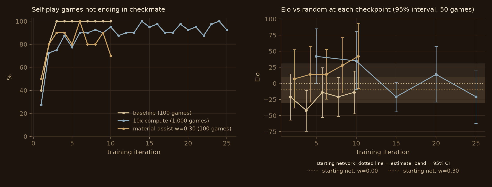

# An AlphaZero-Style Chess Engine, Built From Scratch: Implementation, Results, and the "Draw Cycle"

> **Technical report.** A from-scratch AlphaZero-style chess engine: the
> implementation, a controlled study of the training plateau I call the *draw
> cycle*, and the engineering decisions behind a deployed, honest demo. All
> empirical figures in §5 come from a real GPU run (Kaggle, 2× Tesla T4,
> 2026-07-14, ~9.8 h training); the full per-iteration data is in
> [`experiment-results.md`](experiment-results.md).

---

## 1. Abstract

I implemented an AlphaZero-style chess engine from first principles in ~4,200 lines
of Python and PyTorch: the policy/value network, PUCT Monte-Carlo tree search and the
self-play training loop, with no reinforcement-learning libraries (`python-chess`
supplies only the rules). Training runs and the losses fall, but self-play quickly
collapses into what I call the **draw cycle**: when nearly every game is drawn, the
value target is 0 everywhere, the value head learns that every position is even, and a
search guided by it has no reason to convert an advantage. In the baseline run every
self-play game from iteration 3 onward ends in threefold repetition.

I ran three arms on a GPU (one training seed each): a baseline, 10× the self-play, and
a 0.30 material term blended into the search's leaf value. Evaluated against a random
mover and compared with **the network they all started from**, under the same search:
the baseline changes by −22 Elo (95% CI −56, +12), the 10× arm by +10 (−26, +45), and
the material-assisted arm by **+31 (+3, +60)**. Only the assisted arm shows a measurable
gain, and only just. Ten times the compute leaves 88% of self-play games undecided.

An earlier version of this report claimed the assist "flips Elo from −21 to +28" and that
the plateau is "primarily a signal problem." That comparison was confounded (the arms
were evaluated with different searches), had no starting-network reference and no
intervals; §5.4 explains the correction and the control experiments behind it. The
project also ships a deployed web app: a classical alpha-beta engine (about 1390 against
strength-limited Stockfish) as an honestly labelled opponent, and the trained network
running in the browser via ONNX behind a JavaScript↔Python encoding self-check.

## 2. Introduction

AlphaZero is famous for a startling claim: starting from random weights and playing
only against itself, with **zero human strategic knowledge** beyond the rules, a
single algorithm learns superhuman chess, shogi, and Go. That claim is easy to
*read* and hard to *feel*. I wanted to feel it — to write the network, the search,
and the self-play loop myself and watch a program teach itself to play with code I
understood line by line, rather than `pip install`-ing an engine and watching it
win. Building from first principles is also the only way to meet the parts of
AlphaZero that are conceptually simple but genuinely subtle: a value sign flipped at
the wrong ply, or a board not mirrored for Black, does not crash — it silently stops
the network from learning. Confronting those is where the understanding lives.

The honest outcome is more interesting than a clean success. The machinery ran —
loss fell, self-play fed itself — and then stalled in the draw cycle. Rather
than paper over that, I treated it as the object of study. This report makes three
contributions:

1. **A clean, tested, from-scratch implementation** (§4) of all three AlphaZero
   components, with the silent-failure modes pinned down by unit tests.
2. **A diagnosis of the draw cycle** (§5–§6): instrumentation that identifies the
   value-target collapse, three arms that vary compute and the self-play signal, and
   controls (§5.4) that measure each arm against the network it started from. They
   also correct this report's own earlier, confounded reading of those arms.
3. **Engineering decisions under real constraints** (§7): a two-engine architecture
   that keeps the demo both strong and honest, and a free-tier deployment that runs
   the trained network in the browser with a correctness self-check.

The remainder is organized as method (§4), experiments and results (§5), the draw
cycle analysis (§6), engineering decisions (§7), limitations and future work (§8),
and conclusion (§9), with reproducibility details in §10.

## 3. Background

AlphaZero rests on three interlocking pieces.

**A policy/value network.** A single neural network `f(s) = (p, v)` maps a board
state `s` to a **policy** `p` — a prior probability over legal moves — and a
**value** `v ∈ [−1, 1]` estimating the game's eventual outcome from the side to
move's perspective. One shared trunk feeds both heads, a form of multi-task learning
(the features that judge a position largely overlap with those that choose a move).

**PUCT Monte-Carlo Tree Search.** Rather than trust the raw network, AlphaZero uses
it *inside* a search. MCTS builds a tree of candidate lines; at each node it selects
children by the PUCT rule, which balances the network's prior and the running value
estimate against how often a move has been tried. Crucially, the classic random
rollout to game's end is replaced by a single call to the value head at the leaf.
The search's visit counts form a **sharper policy** than the network's own prior —
"search as policy improvement," the engine of learning.

**A self-play training loop.** The engine plays itself using MCTS. Every position
becomes a training example whose policy target is the MCTS visit distribution and
whose value target is the game's final result. Training the network to match those
targets makes the *next* search stronger, whose games make *better* targets — a
virtuous cycle. The only inputs are the rules; all strength is bootstrapped.

These three interlock tightly: the network is the search's evaluation function, the
search is the network's teacher, and self-play is the data source that couples them.
The draw cycle (§6) is what happens when one link — the value target — degenerates.

---

## 4. Method / Implementation

The system is ~4,200 lines of Python + PyTorch with no reinforcement-learning
libraries; `python-chess` is used only for the rules (legal-move generation and
terminal-state detection), so all intellectual effort sits in the encoding, the
network, the search, and the training loop.

### 4.1 Problem encoding

**Board → tensor** (`chess_game.encode_board`). Each position becomes an
`18 × 8 × 8` tensor:

| Planes | Count | Contents |
|---|---|---|
| Piece planes | 12 | 6 piece types × 2 colours |
| Castling rights | 4 | us K/Q-side, them K/Q-side |
| En-passant | 1 | target square, if any |
| Half-move clock | 1 | progress toward the 50-move rule |

Crucially, the board is encoded in **canonical (side-to-move) form**: when it is
Black's turn the board is mirrored, so the network only ever reasons about "the
player at the bottom, to move." This makes the network colour-agnostic and roughly
halves what it must learn.

**Move → index** (`move_to_index` / `index_to_move`). Moves use the canonical
AlphaZero action space of `64 × 73 = 4672`:

| Plane range | Count | Meaning |
|---|---|---|
| 0–55 | 56 | "queen" moves: 8 directions × 7 distances |
| 56–63 | 8 | knight moves (the 8 L-jumps) |
| 64–72 | 9 | under-promotions: {N,B,R} × {left, fwd, right} |

Queen-promotions reuse the "queen" move planes, so they need no dedicated encoding.
The mapping is bijective on legal moves and is verified by round-trip tests (§4.5).

### 4.2 Network architecture

A single small, CPU-friendly residual CNN (`model.py`) with a shared trunk and two
heads — a form of multi-task learning, since the features useful for choosing a move
largely overlap with those useful for judging a position:

```
input (18 × 8 × 8)
  → Conv 3×3 + BN + ReLU                         (stem)
  → N × ResidualBlock   (default N=4, 64 channels) (trunk)
  → policy head: Conv 1×1 + BN + ReLU → FC → 4672 logits
  → value  head: Conv 1×1 + BN + ReLU → FC → ReLU → FC → tanh  ∈ [-1, 1]
```

The value head's `tanh` output is interpreted as expected game outcome from the
side-to-move's perspective (`+1` winning, `0` drawish, `-1` losing). Residual
("skip") connections let gradients bypass each block so the tower trains without
vanishing signal.

### 4.3 Search: PUCT Monte-Carlo Tree Search

`mcts.py` is the algorithmic heart. The classic Monte-Carlo rollout is replaced by a
single call to the network's **value head**, and the **policy head** supplies a
prior that focuses the search. Each of `num_simulations` (default 100) iterations
walks the tree through four phases:

1. **Selection** — descend from the root by maximising the PUCT score until a
   not-yet-expanded node is reached.
2. **Expansion** — evaluate that leaf with the network to get a value and a prior
   distribution; create one child per legal move.
3. **Evaluation** — the leaf's value is the network estimate (or the exact result
   at a terminal node).
4. **Back-up** — propagate the value up the path, **flipping its sign at every ply**
   because the players alternate.

The selection score balances exploitation and exploration:

```
score(child) = Q(child) + c_puct · P(child) · √N(parent) / (1 + N(child))
```

During self-play, **Dirichlet noise** (`alpha = 0.3`, `epsilon = 0.25`) is mixed
into the root priors to keep exploration alive. To keep memory modest, nodes store
only the move that reaches them and reconstruct the position by replaying from the
root during selection.

### 4.4 Self-play and training targets

Self-play (`self_play.py`) is the "reinforcement": the engine is its own opponent
and its own teacher. For every move it records a training example:

- **state** — the canonical board tensor the network saw;
- **policy target** — the **MCTS visit-count distribution** (a *better* policy than
  the raw network output, because search refined it — this "search as policy
  improvement" is what makes the network get stronger);
- **value target** — filled in at game end: `+1 / 0 / −1` for the side to move.

For the first `temperature_moves = 15` plies, moves are sampled in proportion to
visit counts (diverse openings); thereafter play is greedy. A `max_moves = 200`
cap prevents weak early networks from shuffling forever.

**Loss** (`alphazero_loss`, `training.py`):

```
loss = −Σ πᵢ · log_softmax(policy_logits)ᵢ  +  c · (z − v)²
        └── cross-entropy to MCTS target ──┘     └─ MSE to outcome ─┘
```

The outer loop runs `num_iterations` rounds of *(generate self-play → train on the
replay buffer for `epochs_per_iteration` epochs)*. Self-play games are independent,
so a multiprocessing path fans them across CPU cores — the single biggest practical
speed-up, since self-play dominates wall-clock time.

### 4.5 Correctness: making the silent bugs loud

AlphaZero is conceptually simple but subtle to get *right*: the dangerous bugs don't
crash, they silently stop the network from learning. Two are called out and pinned
down with tests:

- **Perspective / colour symmetry** — the board must be mirrored for Black and value
  signs flipped consistently up the tree. Tested by
  `test_canonical_encoding_is_color_symmetric` and `test_material_score_perspective`.
- **Move-encoding integrity** — the 4672-space mapping must round-trip, including
  promotions. Tested by `test_move_encoding_roundtrip_white` /
  `_promotions` and `test_move_index_in_range_for_all_legal_start_moves`.

The full suite (44 tests, run in CI) also covers terminal values
(`test_terminal_value_checkmate`, `test_stalemate_is_a_draw`,
`test_insufficient_material_is_a_draw`), search behaviour
(`test_mcts_returns_valid_distribution`, `test_mcts_is_deterministic_without_noise`,
`test_search_finds_mate_in_one`), and the Elo math
(`test_elo_difference_monotonic_and_symmetric`).

### 4.6 A second, classical engine (and why)

An untrained network + MCTS shuffles winning positions into draws, which makes for a
poor playable demo. Rather than disguise that, the project ships a **second**,
dependency-light engine (`search.py`) as the play-time opponent and is explicit on
the site about which engine is doing what:

- **Negamax + alpha-beta** at fixed depth, with **quiescence search** on captures so
  it doesn't blunder at the horizon;
- **Move ordering** (captures first, most-valuable-victim) for pruning;
- Evaluation = **material** + an **endgame "mop-up"** term (drive the lone king to a
  corner, bring your own king up, squeeze escape squares) so it can actually deliver
  basic mates;
- Draws score `0` and mate scores are depth-adjusted, so a winning side refuses to
  repeat and prefers the *fastest* mate.

This is itself an engineering-judgment result (§7): use each tool where it is
genuinely strong, and tell the user the truth about what they are playing.

---

## 5. Experiments and Results

> **Provenance.** One GPU run (Kaggle, 2× Tesla T4, `run_experiment.py --device cuda`,
> 2026-07-14, ~9.8 h). Its automatic push failed, so its numbers are transcribed from
> the captured output into [`experiment-results.md`](experiment-results.md) and, machine-readable,
> [`data/gpu_run_2026-07-14.json`](data/gpu_run_2026-07-14.json). Its raw logs and trained
> checkpoints were lost with the session. The controls in §5.4 were run on 2026-11-14 on a CPU.

### 5.1 Training dynamics

| Arm | Policy loss (start → end) | Value loss (start → end) |
|---|---|---|
| baseline | 4.54 → 0.81 | 0.092 → 0.006 |
| scaled | 4.02 → 0.96 | 0.164 → 0.012 |
| assisted | 4.37 → 0.69 | 0.101 → 0.023 |

Neither curve is evidence of learning to play. The policy targets are the search's own
visit distributions, which sharpen as the network does, so a falling cross-entropy partly
tracks falling target entropy. The value loss is small from the start and falls toward
zero because, with almost every game drawn, the target `z` is 0 nearly everywhere: the
draw-cycle signature (§6). Per-iteration loss curves for the GPU run were not recovered.

### 5.2 Measuring strength

`evaluation.py` plays a network (greedy MCTS, 50 simulations, no noise) against a
uniformly random mover over 50 games with colours alternated and a 200-move cap, and
converts the score `S` to Elo by `−400 · log10(1/S − 1)`. Each game scores 1, ½ or 0, so
the interval uses the per-game variance of the observed W/D/L split
(`MatchResult.score_interval`). With 84–90% draws, a 50-game match is about ±40 Elo at 95%.

Random is a weak yardstick: it separates a broken engine from a working one, not a good
engine from a better one. It is used here because the networks are weak enough that a
stronger opponent would score 0%.

### 5.3 Three arms

All three arms train from the same seed-42 network and differ in one variable each.

| Arm | Self-play games | Sims / move | Material w | Checkmates in self-play | Elo vs random, pooled (95% CI) |
|---|---|---|---|---|---|
| baseline | 100 | 100 | 0 | 8% | −22 (−38, −7) |
| scaled (10×) | 1,000 | 160 | 0 | 12% | +10 (−8, +28) |
| assisted | 100 | 100 | 0.30 | 19% | +21 (+1, +41) |

Elo is pooled over each arm's five periodic checkpoints (250 games). Every individual
checkpoint interval in the assisted arm includes zero.



### 5.4 A confound, and the controls that correct it

`NetworkAgent` builds its search from the run's `MCTSConfig`, so the assisted network
was evaluated with the material blend inside its search and the baseline without it.
The original comparison ("−21 → +28") therefore set two different searches against each
other and credited the whole difference to learning.

Two controls separate the effects ([`tools/no_learning_control.py`](../tools/no_learning_control.py)):

| Network (never trained) | Material w | W / D / L | Elo vs random (95% CI) |
|---|---|---|---|
| starting network, seed 42 (100 games) | 0 | 10 / 80 / 10 | 0 (−31, +31) |
| starting network, seed 42 (100 games) | 0.30 | 3 / 91 / 6 | −10 (−31, +10) |
| seeds 1–3 pooled (150 games) | 0 | 41 / 98 / 11 | +70 (+39, +103) |
| seeds 1–3 pooled (150 games) | 0.30 | 7 / 137 / 6 | +2 (−14, +19) |

Two things follow. The heuristic alone does not beat random; it turns games into draws.
And initialisation alone moves an untrained network from about −7 (seed 3) to about +110
(seeds 1, 2), so comparisons between single-seed arms carry far more noise than their
match intervals suggest. The right reference for each arm is the network it started from,
under the search it was evaluated with:

| Arm | Trained, pooled | Starting network | Change (95% CI) |
|---|---|---|---|
| baseline | −22 | 0 | −22 (−56, +12) |
| scaled (10×) | +10 | 0 | +10 (−26, +45) |
| assisted | +21 | −10 | **+31 (+3, +60)** |

**What the data supports.** The draw cycle in self-play is real, and 10× the self-play
does not escape it. Neither unassisted arm measurably changed strength. The assisted arm
gained a little over its own start: +31 Elo, just clear of zero, from one training seed.
It cannot rank compute against signal; the earlier claim that it could is withdrawn.

### 5.5 What would settle it

Three training seeds per arm; every network evaluated with `material_weight = 0` as well
as under its training search; the combined arm (10× compute with the assist); and a
stronger reference opponent than random once a network can score against one.
`run_experiment.py --seed N` now writes each seed to its own directory and evaluates every
assisted arm both ways, so this is one command per seed.

---

## 6. The Draw Cycle

The central empirical finding, and the report's intellectual core.

**The observation.** The machinery worked — the network trained, loss fell, self-play
fed itself — and then strength plateaued. The engine could *win* material but not
*convert* it: up a queen, it would shuffle until the game petered out into a
repetition draw. Against a random-move opponent it drew 84–90% of games and lost a few (§5.2).

**The mechanism.** This is a property of how AlphaZero learns, not a coding fault.
The value head is trained to predict the game outcome `z`. If nearly every self-play
game is a **draw**, then `z ≈ 0` for almost all training targets, so the only thing
the value head can learn is *"every position is even."* A value head that always
returns ≈0 cannot tell the search that being up a queen is *good*, so MCTS never
prioritises converting the advantage, so games stay drawn, so the next batch of
targets is again all-draws. A **self-reinforcing trap** — the *draw cycle*.

**The diagnosis.** Nothing was broken, which is what made it hard. The break came
from **logging the termination reason of every self-play game**: the histogram was
dominated by draws, which pointed at the value-target collapse rather than a bug.
The deeper lesson — and the hardest thing the project taught — is that *"my code is
wrong"* and *"my code is right but under-resourced"* look identical from the outside;
only instrumentation tells them apart. AlphaZero trained on tens of millions of
games; a laptop plays under a hundred.

**Why the arms in §5.3 are the right test, and what they need.** Because the two
explanations are externally indistinguishable, the honest move is to *test* the resource
hypothesis by scaling compute while holding the code fixed. §5.4 shows the other half of
that discipline: each arm has to be compared with its own starting point, under the same
search, with intervals, before any lever gets credit.

**A likely secondary factor.** Real AlphaZero includes **move-history planes** in the
board encoding, which help the network reason about repetition; their absence here
plausibly deepens the draw cycle and is a natural future-work item (§8).

---

## 7. Engineering Decisions and Challenges

The science above lives inside a real, deployed product, and three engineering
decisions shaped it. Each began as a constraint and became a design I stand behind.

**7.1 Two engines, honestly labeled.** The trained network is, by §5, too weak to be
a satisfying opponent — it shuffles won positions into draws. I could have quietly
propped it up and called it "the AI." Instead I built a *second* engine
(`search.py`): a classical negamax alpha-beta searcher with quiescence search,
move ordering, piece-square tables, and an endgame "mop-up" term so it actually
delivers mate. The site is explicit about which engine is playing — the classical
engine gives a genuinely strong game *today*, while the neural network remains the
honestly-described *learning* project you can also play. This is the report's core
engineering-judgment claim: use each tool where it is actually strong, and tell the
user the truth about what they are facing. A demo that lies about itself is worse
than one honest about its limits.

**7.2 Running a PyTorch model on a free tier.** A PyTorch web service is multiple
gigabytes — too large for the free hosts this project targets. Two constraints
turned into a cleaner architecture. First, because the classical engine and the
board encoding need **no** PyTorch, the whole site ships as a tiny, dependency-light
FastAPI service (`web/server.py`, `requirements.txt` is just `python-chess` +
`fastapi` + `uvicorn`). Second, to still let visitors play the *trained network*, I
export it to **ONNX** and run inference **in the browser** (`onnxruntime-web`) — no
model on the server at all. The subtle risk is that the JavaScript board encoding
must byte-for-byte match the Python one, or the network sees garbage; a single
off-by-one plane would silently weaken it. `export_web_model.py` therefore emits a
set of **golden** `(FEN → value)` pairs alongside the model, and the client verifies
its own encoding against them before trusting the network (`model_meta.json`). The
constraint forced a design that is both cheaper *and* more correct than a naïve
server-side deployment.

**7.3 Parallel self-play that didn't exhaust memory.** Self-play dominates wall-clock
time and the games are independent, so I fan them across CPU cores with
multiprocessing. Early runs crashed under memory pressure: each worker's math
library (BLAS) spun up its own thread pool, oversubscribing the CPU and ballooning
memory. The fix was to cap the per-process thread count and fall back to sequential
self-play when memory is tight — an unglamorous but real lesson that parallelism on
shared hardware is about *resource arithmetic*, not just spawning workers.

A recurring theme connects the three: each constraint (a weak model, a size limit,
a memory ceiling) was not an obstacle to hide but information that produced a better
design.

## 8. Limitations and Future Work
- **One training seed per arm.** Untrained networks alone span more than 100 Elo against
  random across init seeds (§5.4). Three seeds per arm is the minimum for any ranking.
- **Transcribed data.** The GPU run's logs and checkpoints were lost; its numbers are
  transcribed from captured output. Code history begins on 2026-07-18, four days after
  the run, so the seed-42 starting network is reconstructed on the assumption that the
  initialisation code did not change in between.
- **A weak yardstick.** Random separates broken from working, not good from better.
- **The playable network is not a GPU network.** The site serves `checkpoints/best.pt`,
  iteration 2 of a short CPU run.
- **Move-history planes (the encoding hypothesis).** Real AlphaZero stacks the last
  *T* positions in its input, which helps the network reason about repetition, a
  plausible further cause of the draw cycle. Adding them is non-trivial because MCTS
  clones the board with `stack=False` and rebuilds positions by replaying from the root,
  so pre-root history is not consistently available inside the search; it has to be
  threaded through so self-play and leaf evaluation see the same encoding.
- **Larger networks and more compute**, once the seeds above make a comparison possible.

## 9. Conclusion

Building AlphaZero from first principles taught me how the network, the search and the
self-play loop fit together at the level of code, and why its famous simplicity hides
real subtlety: the dangerous bugs are silent, so the discipline is to make them loud
with tests (§4.5).

The draw cycle taught the same lesson twice. First, "my code is wrong" and "my code is
right but under-resourced" look identical from the outside, and only instrumentation
told them apart. Second, my own first analysis of the experiments made exactly the
kind of error the project was supposed to guard against: it compared networks evaluated
with different searches, without the network they started from and without intervals,
and drew a clean conclusion from it. Rebuilding the starting network and measuring
against it (§5.4) left a smaller and more honest result: the draw cycle is real, extra
compute does not escape it, and the material assist is the only arm with a measurable,
marginal gain. The next step is not a bigger run but three seeds per arm.

## 10. Reproducibility

**Repository.** <https://github.com/Danny-397/RL-Chess-Engine> (MIT). The code is
~4,200 lines (excluding tests); the 44-test suite runs in CI on every push.

**Environment.** `pip install -r requirements-train.txt` (adds PyTorch to the
light runtime deps in `requirements.txt`). The GPU results in §5 were produced on
Kaggle with 2× Tesla T4.

**Configuration (from `config.py`).** All three §5 stages share the network and
hyperparameters below and differ only in the variables under test (iterations,
games/iteration, simulations, and the self-play `material_weight`):

- Network: `num_residual_blocks = 4`, `num_channels = 64`
- Search: `num_simulations` per stage, `c_puct = 1.5`,
  `dirichlet_alpha = 0.3`, `dirichlet_epsilon = 0.25`
- Self-play: `temperature_moves = 15`, `max_moves = 200`
- Training: `epochs_per_iteration = 4`, `batch_size = 64`,
  `learning_rate = 1e-3`, `weight_decay = 1e-4`, `replay_buffer_size = 20,000`

| Stage | Iterations | Games/iter | Sims/move | Self-play material w |
|---|---|---|---|---|
| baseline | 10 | 10 | 100 | 0.00 |
| scaled | 25 | 40 | 160 | 0.00 |
| assisted | 10 | 10 | 100 | 0.30 |

**Commands.**

```bash
# Reproduce all three §5 stages (Experiments A and B), resumable:
python run_experiment.py --device cuda

# Validate the whole pipeline fast on CPU (~1–2 min; results not meaningful):
python run_experiment.py --quick

# Train / evaluate directly:
python main.py --mode train --iterations N --games G --simulations S \
    --eval-every K --save-pgn --device cuda
python main.py --mode eval --checkpoint checkpoints/best.pt --opponent random --eval-games 50

# Rebuild Figure 1 and rerun the control:
python tools/plot_draw_cycle.py          # from docs/data/*.json
python tools/no_learning_control.py      # §5.4 control (CPU, about 1 hour)
```

Figure 1 is rebuilt from `docs/data/gpu_run_2026-07-14.json` (the transcribed GPU
run) and `docs/data/no_learning_control.json` (the control).

## 11. References

1. D. Silver et al. *Mastering the game of Go without human knowledge.* Nature 550, 354–359 (2017). AlphaGo Zero: the policy/value network, PUCT search and self-play loop used here.
2. D. Silver et al. *A general reinforcement learning algorithm that masters chess, shogi, and Go through self-play.* Science 362, 1140–1144 (2018). AlphaZero, including the 8 × 8 × 73 move encoding and the Dirichlet root noise.
3. C. D. Rosin. *Multi-armed bandits with episode context.* Annals of Mathematics and Artificial Intelligence 61, 203–230 (2011). The PUCT selection rule.
4. A. E. Elo. *The Rating of Chessplayers, Past and Present.* Arco (1978). The logistic score-to-rating relation used for every Elo figure here.
5. Leela Chess Zero contributors. *lc0* (open-source AlphaZero reproduction), https://lczero.org. A large-scale reference point for what this report's compute budget is not.
